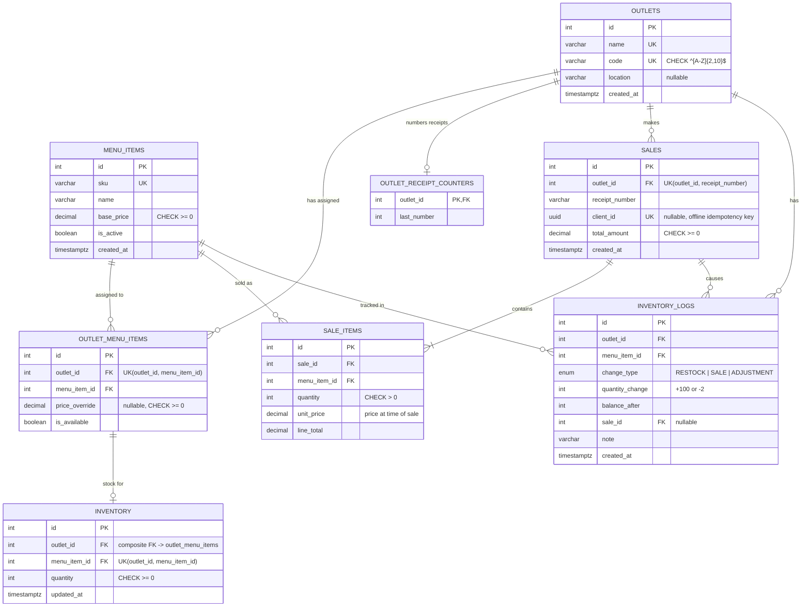

# Architecture

## Stack
Node.js (CommonJS) · Express 5 · Zod 4 · Prisma 6.19 · PostgreSQL 16 · React (Vite) frontend · Docker

## Repo layout
```
fnb-hq/
  backend/              Express API (below)
  frontend/             React (Vite) app: HQ screens + outlet POS screen
  docker-compose.yml    db + api + frontend
  README.md             setup, endpoints, schema, architecture, scaling
```

## Backend folder structure
```
backend/
  Dockerfile
  prisma/schema/        one model per file, migrations/
  prisma/seed.js
  src/
    app.js              express app, middlewares, /health + /api
    server.js           starts the server
    routes.js           mounts each module's routers under /api
    modules/            one folder per business module (modular monolith, see below)
      outlet/           outlets + receipt counter
      inventory/        stock + stock logs
      menu/             master menu, outlet assignments, outlet-facing menu
      sales/            sales transaction + receipt numbering
      reporting/        HQ reports (read-only, raw SQL)
      health/           GET /health
    shared/
      db/prisma.js      single PrismaClient instance
      middleware/       validate, errorHandler, notFound
      utils/            AppError, response, money helpers
      validators/       common Zod pieces (id, money)
```
Inside a module, files are named `<name>.<layer>.js` (`sales.routes.js`, `sales.validator.js`, `sales.controller.js`, `sales.service.js`, `sales.repository.js`), plus `index.js`.

## Modules (modular monolith)
| Module | Owns (writes) | Public API (`index.js`) | Depends on |
|---|---|---|---|
| `outlet` | `outlets`, `outlet_receipt_counters` | `hqRoutes`, `findById`, `ensureExists`, `nextReceiptNumber` | none |
| `inventory` | `inventory`, `inventory_logs` | `hqRoutes`, `initStock`, `deductStock`, `getQuantity`, `writeLogs` | outlet |
| `menu` | `menu_items`, `outlet_menu_items` | `hqRoutes`, `outletRoutes`, `findAssignmentsForSale` | outlet, inventory |
| `sales` | `sales`, `sale_items` | `outletRoutes` | outlet, menu, inventory |
| `reporting` | none (read-only) | `hqRoutes` | none (reads outlet, menu, sales tables directly) |
| `health` | none | `routes` | none |

Rules:
- Inside a module: `route → validator → controller → service → repository` (layer rules below).
- Across modules: a service may `require("../<module>")` (its `index.js`) only. Never another module's repository, service, controller, routes or validator file.
- API functions take an optional `tx`, so a flow across modules (for example a sale) stays one `prisma.$transaction`.
- A module writes only the tables it owns. For example, assigning an item creates the inventory row through `inventory.initStock`.
- No dependency cycles: `outlet ← inventory ← menu ← sales`. A new module (for example `reporting`) sits on top.
- The receipt counter row is owned by `outlet` (created in the outlet's transaction). `sales/receipt.service.js` asks `outlet.nextReceiptNumber` and formats `CODE-000001`.
- Check: `grep -rnE 'require\("\.\./[a-z]+/[a-zA-Z]+\.(repository|service|routes|controller|validator)"\)' src/modules` must return nothing.

Split points (read-only joins across module tables, to replace with API calls or read models if a module becomes a service):
- `inventory.repository.findAllByOutlet` includes `outletMenuItem.menuItem` (sku, name, isActive, isAvailable).
- `menu`'s assignment and outlet-menu queries read `inventory.quantity`.
- `sales.repository` includes `menuItem` (sku, name) on sale items.
- `reporting.repository` reads `outlets`, `sales`, `sale_items`, `menu_items` with raw read-only SQL (aggregates + `ROW_NUMBER()`). As separate services this becomes a read model / replica.
- The sale itself needs outlet + menu + inventory in one ACID transaction. As separate services that becomes a saga (reserve stock → create sale → confirm/compensate), so outlet-ops (sales + inventory) should be split together, if at all.

## Layer rules
| Layer | Does | Must NOT |
|---|---|---|
| Route | map URL + validator + controller | contain logic |
| Validator | check body/params/query with Zod | touch DB |
| Controller | take req, call service, return JSON | contain business rules or Prisma |
| Service | business rules, transactions | use req/res |
| Repository | Prisma queries | contain business rules |

Flow: `route → validate → controller → service → repository → DB`

## API groups
- `/api/hq/*`      HQ: outlets, menu items, assignments, inventory, reports
- `/api/outlets/:outletId/*`  Outlet: menu, sales

## Endpoints
| Method | Path | Purpose |
|---|---|---|
| GET | `/health` | Liveness + DB ping (for the deployed instance) |
| POST | `/api/hq/outlets` | Create outlet (+ receipt counter) |
| GET | `/api/hq/outlets` | List outlets (ordered by id) |
| GET | `/api/hq/outlets/:id` | Single outlet (404 `OUTLET_NOT_FOUND`) |
| PATCH | `/api/hq/outlets/:id` | Update name / location (`null` clears location). `code` is immutable → 400 |
| POST | `/api/hq/menu-items` | Create master menu item |
| GET | `/api/hq/menu-items?isActive=true\|false` | List master menu items (ordered by id, optional filter) |
| GET | `/api/hq/menu-items/:id` | Single menu item (404 `MENU_ITEM_NOT_FOUND`) |
| PATCH | `/api/hq/menu-items/:id` | Update name / basePrice / isActive |
| POST | `/api/hq/outlets/:outletId/menu-items` | Assign item (`menuItemId`, optional `priceOverride`) + create inventory row (qty 0). 404 `OUTLET_NOT_FOUND` / `MENU_ITEM_NOT_FOUND`, 400 `MENU_ITEM_INACTIVE`, 409 `ALREADY_ASSIGNED` |
| GET | `/api/hq/outlets/:outletId/menu-items` | All assignments of an outlet (including unavailable ones) with `basePrice`, `priceOverride`, `effectivePrice`, `stock` |
| PATCH | `/api/hq/outlets/:outletId/menu-items/:menuItemId` | Set / clear (`null`) `priceOverride`, set `isAvailable` (`false` = unassign, `true` = re-enable). 404 `NOT_ASSIGNED` |
| GET | `/api/hq/outlets/:outletId/inventory` | Stock per assigned item (unavailable ones included, flagged). 404 `OUTLET_NOT_FOUND` |
| POST | `/api/hq/outlets/:outletId/inventory/:menuItemId/restock` | `{ quantity: 1..1,000,000, note? }` → RESTOCK log. Returns `{ menuItemId, quantity, log }`. 404 `NOT_ASSIGNED` |
| PUT | `/api/hq/outlets/:outletId/inventory/:menuItemId` | Set absolute `{ quantity: 0..1,000,000, note? }` → ADJUSTMENT log (`new − old`). No change → `log: null`, nothing written. 404 `NOT_ASSIGNED` |
| GET | `/api/hq/outlets/:outletId/inventory/:menuItemId/logs?limit` | Stock movement history, newest first. `limit` 1–200, default 50. 404 `NOT_ASSIGNED` |
| GET | `/api/hq/reports/revenue-by-outlet?from&to` | `[{ outletId, code, name, totalRevenue, saleCount }]`, all outlets (no sales → `"0.00"`, 0), sorted by revenue desc then id. `from`/`to` `YYYY-MM-DD` inclusive UTC; invalid or `from > to` → 400 `VALIDATION_ERROR`. 1 query |
| GET | `/api/hq/reports/top-items?outletId&limit&from&to` | `[{ outletId, code, items: [{ menuItemId, name, qtySold, revenue }] }]`, top `limit` (1–50, default 5) per outlet by qty, ties: revenue desc, name asc. Omit `outletId` = all outlets; no sales → `items: []`. 404 `OUTLET_NOT_FOUND`. 1 query (`ROW_NUMBER() OVER (PARTITION BY outlet)`) |
| GET | `/api/outlets/:outletId/menu` | Outlet's sellable menu: assigned + `isAvailable` + `isActive` only. `[{ menuItemId, sku, name, price (effective), stock, inStock }]` sorted by name. Single JOIN query (1 round trip). 404 `OUTLET_NOT_FOUND` |
| POST | `/api/outlets/:outletId/sales` | Create sale `{ items: [{ menuItemId, quantity 1..1000 }] (1–50), clientId?: uuid }`. **201** new sale, **200** replay of an existing `clientId`. 404 `OUTLET_NOT_FOUND` / `NOT_ASSIGNED`, 400 `ITEM_NOT_SELLABLE`, 409 `INSUFFICIENT_STOCK` (details: item, requested, available) / `CLIENT_ID_CONFLICT` |
| GET | `/api/outlets/:outletId/sales/:saleId` | Sale with items (receipt view). 404 `SALE_NOT_FOUND` (also for another outlet's sale) / `OUTLET_NOT_FOUND` |

There is no DELETE endpoint for assignments. Unassigning means `PATCH isAvailable=false`.
- No authentication (not required). The outlet is identified by :outletId in the URL.

## Response format
Success: `{ "success": true, "data": ... }`
Error:   `{ "success": false, "error": { "code": "INSUFFICIENT_STOCK", "message": "..." } }`

## Error handling
- Throw `new AppError(statusCode, code, message)` from services.
- Express 5 forwards rejected promises from async handlers to the error middleware, so no `asyncHandler` wrapper is used.
- One global `errorHandler` middleware converts errors to the JSON above.
- Status codes: 400 validation, 404 not found, 409 conflict (stock/duplicate), 500 unexpected.
- Prisma P2002 (unique) → 409, P2025 (not found) → 404.
- Error codes from `errorHandler`:

  | Source | Status | code |
  |---|---|---|
  | `AppError` | its own | its own |
  | Invalid JSON body | 400 | `INVALID_JSON` |
  | Body too large | 413 | `PAYLOAD_TOO_LARGE` |
  | Zod failure (`validate` middleware) | 400 | `VALIDATION_ERROR` (`details` = `z.treeifyError` per body/params/query) |
  | Unknown route | 404 | `ROUTE_NOT_FOUND` |
  | Prisma P2002 | 409 | `DUPLICATE` (`details.fields`) |
  | Prisma P2025 | 404 | `NOT_FOUND` |
  | Prisma P2003 | 409 | `FK_CONSTRAINT` (`details.constraint`) |
  | Postgres CHECK (23514) | 409 | `CONSTRAINT_VIOLATION` (`details.constraint`) |
  | `/health` DB ping fails | 503 | `DB_UNAVAILABLE` |
  | Anything else | 500 | `INTERNAL_ERROR` |
- `error.stack` is included only when `NODE_ENV=development`.
- `/health` goes through all layers too: `health.routes → health.controller → health.service → health.repository` (`SELECT 1`).

## Transactions & concurrency
- Any multi-table write uses `prisma.$transaction(async (tx) => ...)`, and repositories accept `tx`.
- Stock deduct: `updateMany({ where: { quantity: { gte: q } }, data: { quantity: { decrement: q } } })`. If count is 0, throw 409 and roll back.
- Receipt number: increment the outlet's counter (increment: 1) inside the transaction (row lock), formatted as <outlet.code>-<6 digits>, e.g. DHA-000001. (outlet_id, receipt_number) is UNIQUE.
- Every stock change writes an InventoryLog row in the same transaction. `balanceAfter` always comes from the DB, never from JS math on an earlier read:
  - Restock: atomic `UPDATE … SET quantity = quantity + q RETURNING`.
  - Adjust: `SELECT … FOR UPDATE` locks the row, `delta = new − old`, then `UPDATE … RETURNING`.
  - Invariant: Σ `quantity_change` of an item's logs = its current `quantity`.
- **Lock order** (prevents deadlocks between concurrent sales): deduct stock in ascending `menuItemId` order, then increment the receipt counter **last**, then insert Sale/SaleItems/logs. A short sale fails before it touches the counter, so outlets don't serialize on failed sales.
- Sale `balanceAfter`: after `updateMany` succeeds, the row is re-read in the same tx. Our UPDATE holds its lock until commit, so the value is exact.
- Sale tx options: `{ maxWait: 5000, timeout: 10000 }`, so waiting on row locks under load doesn't fail a sale.
- Idempotency: if `clientId` is given and a sale with it already exists, return that sale (200). If it belongs to another outlet → 409 `CLIENT_ID_CONFLICT`. Handle P2002 on `client_id` the same way for races; the losing tx rolls back, so its stock and receipt number are undone.
- Proof: `npm run test:concurrency` (`scripts/concurrency-test.js`, needs the API running) checks oversell, gapless receipts per outlet and `clientId` idempotency under parallel load.
- DB CHECK constraints are the last line of defense (qty ≥ 0, price ≥ 0, outlet code format).

## Indexes
| Index | Serves |
|---|---|
| `outlets.name` UNIQUE, `outlets.code` UNIQUE | Duplicate checks; receipt prefix lookup |
| `menu_items.sku` UNIQUE | Duplicate check, lookup by SKU |
| `outlet_menu_items (outlet_id, menu_item_id)` UNIQUE | Outlet menu (leading `outlet_id`), assignment lookup, composite FK target |
| `inventory (outlet_id, menu_item_id)` UNIQUE | Stock read / atomic deduct per item |
| `inventory_logs (outlet_id, menu_item_id, created_at)` | Stock history per item, newest first |
| `sales (outlet_id, receipt_number)` UNIQUE | Receipt uniqueness per outlet |
| `sales (outlet_id, created_at)` | Revenue report by outlet + date range |
| `sales.client_id` UNIQUE | Offline-sync idempotency |
| `sale_items (sale_id)` | Load a sale's items |
| `sale_items (menu_item_id)` | Top-items aggregation |

## Docker & deployment
- `backend/Dockerfile` (single stage, `node:20-alpine`): copy `package*.json` + `prisma/` → `npm ci --omit=dev` → `npx prisma generate` → copy `src/` → on start `npx prisma migrate deploy && node src/server.js`.
- This requires `prisma` (the CLI) to be in `dependencies`, not `devDependencies`, so `--omit=dev` keeps it for `migrate deploy` at startup. We chose this over a multi-stage build because it is simpler. **Pending:** move `prisma` in `package.json` when the Dockerfile is written.
- Root `docker-compose.yml`: `db` (postgres:16, volume), `api` (depends on db healthcheck, `DATABASE_URL` from env), `frontend` (built static files served by nginx, proxies `/api`).
- Config only from env (`.env` locally, platform secrets when deployed). `/health` is used by the platform health check.

## Data model
See ER diagram below (Mermaid).



## Conventions
- camelCase in JS, snake_case in DB (`@map`).
- Money: prices are `Decimal(10,2)`, totals (`total_amount`, `line_total`) are `Decimal(12,2)`. Money is returned as a string.
- Keep `docs/` in sync whenever the schema or endpoints change.
- Config comes from `.env` only. Never commit `.env`.
- One commit per feature: `feat(sales): ...`
